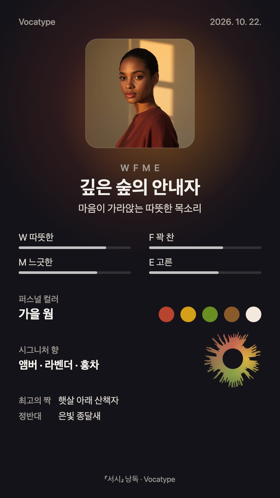

  

<h1 align="center">Vocatype</h1>

  목소리로 그리는 나의 초상 
  A portrait drawn by your voice

<h3 align="center">
  <a href="https://vocatype.hs827.workers.dev">vocatype.hs827.workers.dev →</a>
</h3>

설치 없이 브라우저에서 바로 · PC와 모바일 모두

## 화면

### PC 웹

  <picture>
    <source media="(prefers-color-scheme: dark)" srcset="https://raw.githubusercontent.com/Vocatype/.github/main/profile/images/pc-landing-dark.jpg">
    
  </picture>
  <picture>
    <source media="(prefers-color-scheme: dark)" srcset="https://raw.githubusercontent.com/Vocatype/.github/main/profile/images/pc-result-dark.jpg">
    
  </picture>

### 모바일 웹

  <picture>
    <source media="(prefers-color-scheme: dark)" srcset="https://raw.githubusercontent.com/Vocatype/.github/main/profile/images/m-landing-dark.jpg">
    
  </picture>
  <picture>
    <source media="(prefers-color-scheme: dark)" srcset="https://raw.githubusercontent.com/Vocatype/.github/main/profile/images/m-record-dark.jpg">
    
  </picture>
  <picture>
    <source media="(prefers-color-scheme: dark)" srcset="https://raw.githubusercontent.com/Vocatype/.github/main/profile/images/m-result-dark.jpg">
    
  </picture>
  <picture>
    <source media="(prefers-color-scheme: dark)" srcset="https://raw.githubusercontent.com/Vocatype/.github/main/profile/images/m-reading-dark.jpg">
    
  </picture>

메인 → 녹음 → 결과(초상·타입) → 결과(해설·퍼스널 컬러). GitHub 테마에 따라 라이트·다크 화면이 바뀌어 보입니다.

## 예시 카드

<table>
  <tr>
    <td width="300"></td>
    <td>
      결과는 1080×1920 이미지 한 장으로 저장하거나 바로 공유할 수 있어요.  
      <b>WFME · 깊은 숲의 안내자</b> 
      따뜻하고(W) 꽉 찬(F) 목소리가 느긋하게(M), 고르게(E) 이어지는 타입.  
      퍼스널 컬러 <b>가을 웜</b> · 시그니처 향 <b>앰버 · 라벤더 · 홍차</b> 
      오른쪽 아래 원형 파형은 녹음의 에너지 흐름을 그린 사운드 시그니처예요.  
      예시는 실제 녹음 대신 예시 값으로 그렸어요. 초상은 AI가 타입 코드와 씨앗만 보고 그린 가상 인물이고, 해설 한 줄도 AI가 쓴 글이에요.
    </td>
  </tr>
</table>

## 성격

Vocatype은 짧은 글을 소리 내어 읽으면 그 목소리로 나를 그려 주는 웹 서비스입니다.
브라우저가 피치·에너지·말 속도·음색을 분석해 4축 16가지 보이스 타입으로 나누고, 퍼스널 컬러·시그니처 향·사운드 시그니처·궁합 타입에 AI 초상과 목소리 해설을 더해 카드 한 장으로 만듭니다.

- **목소리는 기기 밖으로 나가지 않습니다.** 분석은 브라우저 안에서 끝납니다. AI 초상에는 타입 코드와 씨앗만, 목소리 해설에는 타입 코드·축 수치·언어만 보냅니다.
- **아무것도 남기지 않습니다.** 로그인, 쿠키, 브라우저 저장소, 외부 분석·광고 스크립트를 쓰지 않습니다.
- **기록하며 만듭니다.** 모든 변경은 번호 붙은 브랜치에서 설계 → 구현 → 독립 리뷰를 거쳐 병합합니다.
- 한국어·영어, 라이트·다크 테마를 지원합니다.

React · TypeScript · Vite / Cloudflare Workers · Workers AI · Claude API

## 개발 기록

<picture>
  <source media="(prefers-color-scheme: dark)" srcset="https://raw.githubusercontent.com/Vocatype/.github/main/profile/activity-dark.svg">
  
</picture>

main 브랜치 커밋을 6시간마다 GitHub Actions가 읽어 다시 그립니다.

## 개발자

<table>
  <tr>
    <td align="center"><a href="https://github.com/hyunseop827"> @hyunseop827</a></td>
    <td align="center"><a href="https://github.com/eric91405"> @eric91405</a></td>
  </tr>
</table>

---

  
    <a href="https://github.com/Vocatype/vocatype">저장소</a> ·
    <a href="https://github.com/Vocatype/vocatype/tree/main/branches">작업 문서</a> ·
    <a href="https://github.com/Vocatype/vocatype/commits/main">커밋 기록</a>
  

